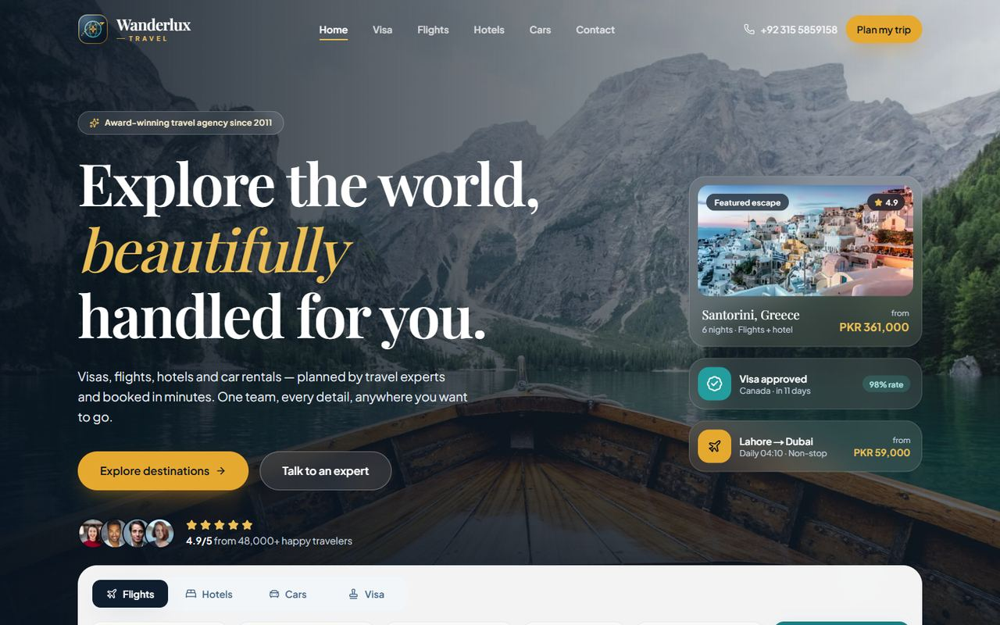
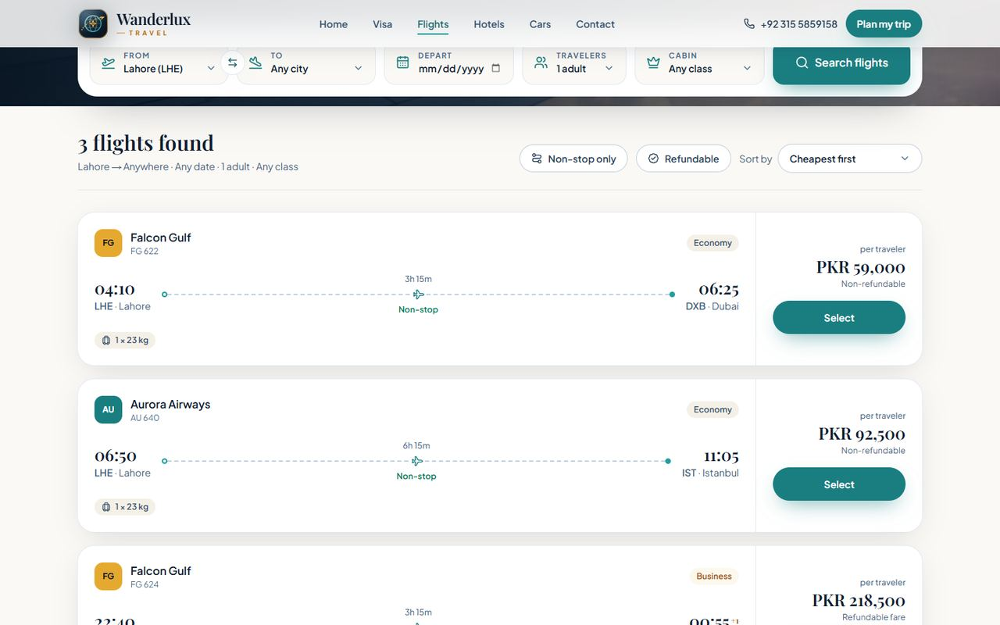

# Wanderlux Travel — Premium Travel Agency Website

A premium, fully responsive travel agency website built as a frontend assessment with **Next.js (App Router)**, **TypeScript**, **Tailwind CSS** and **GSAP**. It covers four services — **Visa Services, Flight Tickets, Hotel Booking and Car Rental** — with working client-side search over local mock data, animated sections and accessible, SEO-friendly markup.

**🔗 Live demo:** [https://your-project.vercel.app](https://your-project.vercel.app) <!-- replace with your Vercel URL -->



---

## ✨ Features

### Pages
| Route | What it does |
| --- | --- |
| `/` | Animated hero with tabbed search widget (Flights · Hotels · Cars · Visa), services, popular destinations, animated stats, why-choose-us, testimonials slider, CTA banner, contact form and footer |
| `/flights` | Flight search by origin, destination, date, travelers and cabin |
| `/hotels` | Hotel search by destination (city/country), dates and guests, with total-stay pricing |
| `/cars` | Car rental search by pick-up location, dates and car type, with total-rental pricing |
| `/visa` | Visa requirements by destination, passport and visa type |
| `/contact` | Validated contact form, contact channels and FAQ |
| `/*` | Custom 404 page and route error boundary |

### Search & results (no backend)
- **URL-driven search** — queries live in the URL (`/flights?from=LHE&to=DXB`), so results are shareable and the back button works. The home widget navigates straight to the matching service page.
- **Client-side filtering** of local mock data, plus **sorting** and **quick-filter chips** (non-stop, refundable, free cancellation, breakfast, automatic, unlimited mileage, visa mode).
- **Loading state** (simulated latency with skeleton cards), **empty state** with "clear filters", and **pagination** (prev/next, page numbers with ellipsis, "Showing 1–5 of 28").
- **Booking flow** — "Select / Book now / Reserve / Apply now" opens the contact form pre-filled with the chosen item.
- All prices in **PKR**.

### Animations (GSAP + ScrollTrigger)
- Hero entrance timeline (background zoom, staggered headline lines, floating highlight cards, scroll parallax).
- Scroll-reveal for every section and staggered card groups.
- Number counters that animate when scrolled into view.
- GSAP hover micro-interactions on cards and buttons (event-delegated, so it covers dynamic results too).
- Staggered entrance for search results, tab panels and the mobile menu.
- **Clean-up & accessibility:** every animation uses `useGSAP` / `gsap.matchMedia()` and is reverted on unmount; all motion is disabled for `prefers-reduced-motion`, and content is never hidden without JavaScript.

### Accessibility
- Semantic landmarks, skip link, labelled forms with inline error messages (`aria-invalid` / `aria-describedby`), focus moved to the first invalid field.
- Custom dropdowns follow the WAI-ARIA *select-only combobox* pattern (arrow keys, Home/End, type-ahead, Escape).
- Tabs follow the WAI-ARIA *tabs* pattern; the testimonials carousel is pausable and never autoplays for reduced-motion users.
- Mobile menu traps focus, closes on Escape and locks page scroll.
- Visible focus rings everywhere; audited with **axe-core (WCAG 2.1 AA) — 0 violations** on all pages at desktop and mobile widths.

### SEO
- Per-page `metadata` (title template, description, canonical URL, Open Graph, Twitter card).
- Generated Open Graph image (`app/opengraph-image.tsx`), `sitemap.xml`, `robots.txt` and web manifest.
- JSON-LD structured data: `TravelAgency` on the home page, `BreadcrumbList` on inner pages.
- All pages are statically prerendered.

### Design
- Consistent palette (navy `ink`, ocean `brand`, warm `gold`, soft `sand`) defined as Tailwind v4 theme tokens.
- Typography via `next/font`: **Playfair Display** (headings) + **Plus Jakarta Sans** (body).
- Optimised images with `next/image` (AVIF/WebP, responsive `sizes`, preloaded hero).
- Mobile, tablet and desktop layouts; sticky navbar with full-screen mobile menu.



---

## 🧰 Tech stack

| Area | Choice |
| --- | --- |
| Framework | [Next.js 16](https://nextjs.org) (App Router, Turbopack, Cache Components) |
| Language | TypeScript (strict) |
| Styling | Tailwind CSS v4 |
| Animation | GSAP 3 + ScrollTrigger, `@gsap/react` (`useGSAP`) |
| Icons | lucide-react |
| Fonts / images | `next/font`, `next/image` |
| Linting | ESLint (`eslint-config-next`) |
| Hosting | Vercel |

---

## 📁 Folder structure

```
.
├── app/                      # Routes (App Router)
│   ├── page.tsx              # Home
│   ├── flights/ hotels/ cars/ visa/ contact/   # Service & contact pages
│   ├── layout.tsx            # Root layout: fonts, metadata, navbar, footer
│   ├── globals.css           # Tailwind v4 theme tokens & base styles
│   ├── not-found.tsx, error.tsx
│   ├── opengraph-image.tsx, sitemap.ts, robots.ts, manifest.ts, icon.svg
├── components/
│   ├── ui/                   # Button, SectionHeading, Logo, LogoMark, SelectMenu
│   ├── layout/               # Navbar, Footer, PageHero
│   ├── cards/                # ServiceCard, DestinationCard, TestimonialCard, ResultCard
│   │   └── results/          # Flight / Hotel / Car / Visa result cards
│   ├── search/               # SearchTabs + the four search forms and fields
│   ├── results/              # Results section, toolbar, skeleton, empty state, Pagination
│   ├── explorers/            # URL-driven search pages (filter → sort → paginate)
│   ├── sections/             # Home page sections & shared contact details
│   ├── forms/                # ContactForm (+ pre-fill from booking links)
│   ├── motion/               # Reveal, CountUp, HoverEffects (GSAP)
│   └── seo/                  # JsonLd
├── data/                     # Mock data: destinations, flights, hotels, cars, visa, testimonials, services, stats
├── lib/                      # Types, filters, search/URL helpers, validation, hooks, GSAP setup, SEO helpers
├── public/images/            # Optimised photography (Unsplash)
└── docs/                     # README screenshots
```

---

## 🚀 Getting started

**Prerequisites:** Node.js **20.9+** and npm.

```bash
# 1. Install dependencies
npm install

# 2. Start the dev server → http://localhost:3000
npm run dev

# 3. Production build & run locally
npm run build
npm run start

# Lint
npm run lint
```

### Environment variables (optional)

Copy `.env.example` to `.env.local`:

| Variable | Purpose |
| --- | --- |
| `NEXT_PUBLIC_SITE_URL` | Absolute site URL for canonical links, Open Graph and the sitemap. On Vercel the production URL is detected automatically, so this is optional. |

---

## ☁️ Deploying to Vercel

1. Push the repository to GitHub.
2. Import it at [vercel.com/new](https://vercel.com/new) — the Next.js preset needs no configuration.
3. (Optional) Set `NEXT_PUBLIC_SITE_URL` to your custom domain.
4. Replace the **Live demo** link at the top of this README with your deployment URL.

---

## 📝 Notes

- **No backend or real APIs.** All data comes from typed files in `/data`; searches are filtered on the client with a short simulated delay. The contact form validates on the client and shows a success message without sending anything.
- Airline and rental-company names are fictional; prices are illustrative and shown in PKR.
- Photography from [Unsplash](https://unsplash.com) (free to use under the Unsplash License).
